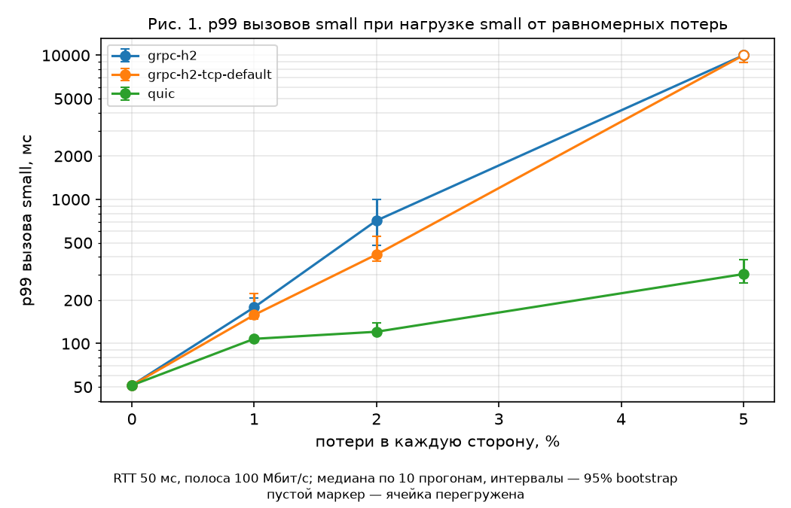
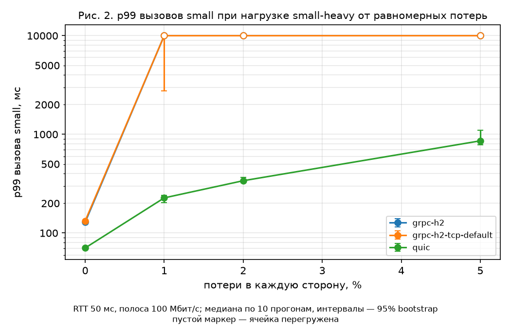
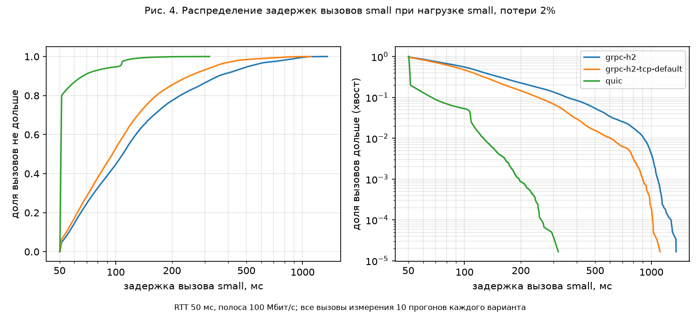
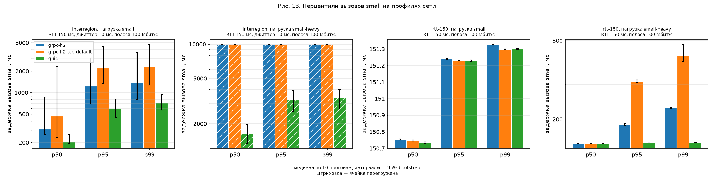

# Пилот (фаза 2)

Пилот проверяет методику на малой матрице до основной серии: держится ли стенд, хватает ли прогрева, каков шум, сколько нужно повторов и годятся ли пороги гипотез. Вердиктов по гипотезам пилот не даёт: [гипотезы](hypotheses.md) проверяются только на основной серии, а их окончательная версия учитывает итоги пилота.

Данные пилота — в [`data/pilot`](../data/pilot): таблицы, рисунки и сводка `report.md` ([схема данных](../data/schema.md#пилотные-данные)). Все вызовы (`calls.parquet`, 25 МБ) — во вложении релиза.

## Постановка

- **Матрица** [`pilot.yaml`](../testbed/scenarios/pilot.yaml):
  - три варианта — RPC на QUIC, gRPC/HTTP/2 на одном соединении с выровненным TCP и gRPC/HTTP/2 с TCP по умолчанию;
  - шесть сетей — базовая точка (RTT 50 мс, 100 Мбит/с), равномерные потери 1, 2 и 5% в каждую сторону, RTT 150 мс и профиль «Межрегион» (RTT 150 мс, джиттер 10 мс, потери 0,5%);
  - две нагрузки — `small` (мелкие unary, 200 вызовов/с) и `small-heavy` (те же мелкие и рядом тяжёлый вызов: ответ 1 МБ раз в секунду);
  - по 10 повторов: прогрев 5 с и 30 с измерения.
- **Объём.** 372 прогона, из них 12 прогонов дрейфа. Серия шла 27 октября 2026 года с 00:13 до 04:19 по Москве, 4 ч 06 мин, около 40 с на прогон вместе с подготовкой стенда. Ни один прогон не упал.
- **Машина:** Intel Core i5-12450H, ядро Linux 6.17, сборка из коммита `1ed41b4`. Машина настроена по NET-5 (`make host-setup`), и прогонов на ненастроенной машине нет. Самопроверка стенда (NET-4) на всех шести сетях — в допуске, отчёты лежат в `data/pilot/check`.

## Методика держится

**Дрейф.** Прогоны базовой точки в начале и в конце серии разошлись не больше чем на 1,5% по p50, p95 и p99 (`drift.csv`). За 4 часа окружение не сдвинулось.

**Прогрев.** Если отношение медианной задержки первых 5 с измерения к остальной части прогона заметно больше 1, значит прогрева не хватило. В ячейках без перегрузки это отношение от 0,48 до 1,43. Значения меньше 1 означают, что задержка растёт к концу прогона, то есть ячейка близка к перегрузке (см. ниже). Единственное значение заметно больше 1 — gRPC при 2% потерь (1,43). Но там сам прогрев не медленнее конца прогона (медианы по 5 с: 104 мс в прогреве, 155 мс в первые 5 с измерения, затем около 100 мс). Это случайные остановки соединения, а не прогрев. **Прогрев 5 с оставлен.**

**Шум и пороги.** В чистой сети полуширина 95%-интервала эффекта не больше 0,02% для нагрузки `small` и не больше 1,1% для p99 при нагрузке `small-heavy` (`comparisons.csv`). Пороги гипотез T4 = 5% и T1 = T2 = 20% больше удвоенного шума. **Пороги не изменились.**

### Разброс и число повторов

Разброс p99 между прогонами измеряется стандартным отклонением его логарифма s_log (`spread.csv`). Чем он больше, тем больше прогонов нужно, чтобы отличить одну и ту же разницу. Наименьшая разница p99, которую критерий Манна–Уитни (α = 0,05, мощность 0,8) отличает при данном числе прогонов на вариант:

| s_log | 10 прогонов | 20 прогонов | 25 прогонов |
| --- | --- | --- | --- |
| 0,02 | 3% | 2% | 2% |
| 0,1 | 14% | 9% | 8% |
| 0,2 | 29% | 20% | 18% |
| 0,3 | 47% | 31% | 28% |
| 0,4 | 67% | 44% | 38% |

В ячейках без перегрузки:

- в чистой сети — не больше 0,02, при RTT 150 мс — не больше 0,13;
- у QUIC под потерями — не больше 0,24;
- у gRPC под потерями — от 0,23 до 0,41;
- у gRPC на «Межрегионе» — 0,86–0,97: половина его прогонов там перегружена, и ячейка на грани.

Наблюдаемые эффекты под потерями — от −32% до −83%, то есть больше того, что 20 прогонов различают при s_log 0,4.

**В основной серии 20 повторов** — нижняя граница из требований. При 25 повторах различимая разница меньше ненамного: 18% вместо 20% при s_log 0,2 и 38% вместо 44% при 0,4. А серия по матрице из требований дольше примерно на 26 часов: около 137 ч вместо 111 ч, при 40 с на прогон.

## Главная находка: перегрузка

Под потерями нагрузка по умолчанию не умещается в соединение:

- **Тяжёлый вызов при потерях от 1% не успевает ни у одного варианта.** У QUIC при 1% потерь в дедлайн 10 с укладываются 3% тяжёлых вызовов, при 2 и 5% — ни одного. У gRPC — ни одного. По оценке Матиса, управление перегрузкой типа Reno/CUBIC при 1% потерь и RTT 50 мс пропускает около 2,8 Мбит/с, а тяжёлый вызов требует 8,4 Мбит/с. Требование «нагрузка не больше 50% полосы» относится к полосе узкого места (100 Мбит/с), а под потерями соединение пропускает гораздо меньше.
- **Мелкие вызовы рядом с ним ведут себя по-разному.** У QUIC мелкие вызовы рядом с застрявшим тяжёлым не перегружены. При 5% потерь перегружены 2 прогона из 10, но ячейка в целом нет; p99 — от 227 до 859 мс. У gRPC/HTTP/2 они застревают за данными тяжёлого вызова в общем потоке байтов TCP, и 48–83% из них падают по дедлайну.
- **При 5% потерь gRPC не справляется и без тяжёлого вызова.** С выровненным TCP gRPC доставляет 0,95 Мбит/с полезных данных из 1,75, с ошибкой завершаются 43% вызовов, а задержка за прогон растёт вдвое. QUIC доставляет всё, p99 303 мс.
- **«Межрегион» с тяжёлым вызовом перегружен у всех вариантов**, и у QUIC тоже: задержка мелких вызовов за прогон растёт в 3,6 раза. Без тяжёлого вызова gRPC здесь на грани: перегружена половина его прогонов, отсюда большой разброс.

Сводка (`cells.csv`, вызовы `small`; «перегрузка» — ячейка перегружена):

| Сеть | Нагрузка | gRPC, выровненный TCP | gRPC, TCP по умолчанию | QUIC |
| --- | --- | --- | --- | --- |
| потери 1% | small-heavy | перегрузка, ошибок 62% | перегрузка, ошибок 48% | p99 227 мс |
| потери 2% | small-heavy | перегрузка, ошибок 51% | перегрузка, ошибок 70% | p99 339 мс |
| потери 5% | small | перегрузка, ошибок 43% | перегрузка, ошибок 6% | p99 303 мс |
| потери 5% | small-heavy | перегрузка, ошибок 83% | перегрузка, ошибок 80% | p99 859 мс |
| Межрегион | small-heavy | перегрузка, ошибок 93% | перегрузка, ошибок 78% | перегрузка, p99 3,4 с |

В перегруженной ячейке p99 упирается в дедлайн или растёт с длиной прогона. Поэтому он не измеряет задержку транспорта, и разница p99 там говорит о другом: справляется ли вариант с нагрузкой. Отсюда правило перегрузки в [гипотезах](hypotheses.md#как-принимается-решение) и [методике](methodology.md#анализ-exp-7-anl-1anl-3).

Нагрузку не облегчали. Это значения по умолчанию из требований, и в отчёте они перечисляются как ограничение. Сценарий «тяжёлая передача рядом с мелкими вызовами в плохой сети» реален, а лёгкий тяжёлый вызов (64 КБ) есть в развёртке EXP-9.

**Почему QUIC выдерживает, а TCP нет, пилот не объясняет.** Управление перегрузкой преимущества QUIC не даёт ([методика](methodology.md#выравнивание-tcp-и-quic-net-6)). При потере оба уменьшают окно одинаково, в 0,7 раза (в quic-go — `renoBeta` в `internal/congestion/cubic_sender.go`). После потери окно у quic-go растёт линейно (Reno), а CUBIC в TCP растит его не медленнее Reno. Кандидаты:

- разное восстановление после потери: таймаут повторной передачи в TCP против проб QUIC;
- общий буфер отправки TCP, в котором мелкие ответы ждут за тяжёлым.

Это вопрос для разбора трасс (ANL-4) и гипотезы H3.

## Первые результаты

Это наблюдения пилота по 10 прогонам на ячейку, а не вердикты. Эффект — медиана p99 QUIC против gRPC/HTTP/2 с выровненным TCP, с 95%-интервалом. Отрицательный эффект — QUIC быстрее.

| Сеть | Нагрузка | p99 gRPC, мс | p99 QUIC, мс | Эффект, % |
| --- | --- | --- | --- | --- |
| базовая | small | 51,3 | 51,3 | −0,03 [−0,04; −0,02] |
| базовая | small-heavy | 129 | 70,5 | −45 [−46; −44] |
| RTT 150 мс | small | 151 | 151 | −0,02 [−0,02; −0,01] |
| RTT 150 мс | small-heavy | 229 | 152 | −33 [−34; −33] |
| потери 1% | small | 178 | 108 | −40 [−48; −31] |
| потери 2% | small | 713 | 121 | −83 [−88; −74] |
| Межрегион | small | 1395 | 718 | −49 [−78; −5], p = 0,08 |

- **Чистая сеть.** Задержки совпадают с точностью до сотых долей процента.
- **CPU.** QUIC тратит заметно больше CPU (`cpu.csv`). На базовой точке при нагрузке `small`:
  - сервер — 185 против 118 мкс на вызов по времени процесса (+57%) и 190 против 127 мкс по занятости ядер (+50%);
  - клиент — +25% и +22%.

  Сервер QUIC уже здесь на пороге H4 (+50%) или выше него, а рядом с тяжёлым вызовом тратит +141% по времени процесса и +92% по ядрам. Порог не менялся: он задаёт допустимую цену, а не шум, и подгонять его под увиденный эффект нельзя.
- **Тяжёлый вызов рядом, без потерь.** Мелкие вызовы gRPC ждут за тяжёлым и в чистой сети: p99 129 мс при RTT 50 мс. У QUIC — 70,5 мс.
- **Сам тяжёлый вызов** в чистой сети у QUIC медленнее: медиана 155 против 138 мс на базовой точке и 371 против 239 мс при RTT 150 мс. Возможная причина — окна управления потоком quic-go. Это нужно проверить.
- **Потери без перегрузки.** При 1% потерь QUIC быстрее на 40%, при 2% — на 83%. На «Межрегионе» разница большая, но интервал широкий и после поправки незначима: gRPC там на грани перегрузки.
- **TCP по умолчанию против выровненного** — по-разному в разных ячейках:
  - при RTT 150 мс с тяжёлым вызовом TCP по умолчанию хуже (p99 418 против 229 мс);
  - при 5% потерь без тяжёлого вызова он перегружается заметно слабее (ошибок 6% против 43%).

  Причину пилот не выясняет.

Рисунки:









## Что пилот не решил

- **Ось джиттера.** В пилоте джиттер был только в профиле «Межрегион». Джиттера 30 мс стенд не принимает ([описание стенда](testbed.md#профили)). Ось задаётся при составлении матрицы основной серии (фаза 4).
- **Нагрузка для точек с узкой полосой** (1 и 10 Мбит/с). По требованиям она уменьшается вместе с полосой, профилей нагрузки для этого пока нет (фаза 4).
- **Причины** перегрузки TCP, медленного тяжёлого вызова QUIC и разницы между TCP по умолчанию и выровненным (ANL-4).

## Как воспроизвести

```sh
make bench-pilot                 # серия на настроенной машине, около 4 часов
make plots SERIES=out/…-pilot    # таблицы, рисунки и сводка в out/…-pilot/analysis
```

Чтобы пересобрать таблицы и рисунки из опубликованных данных, положите `calls.parquet` из релиза в `data/pilot` и запустите `make plots ANALYSIS=data/pilot`.
